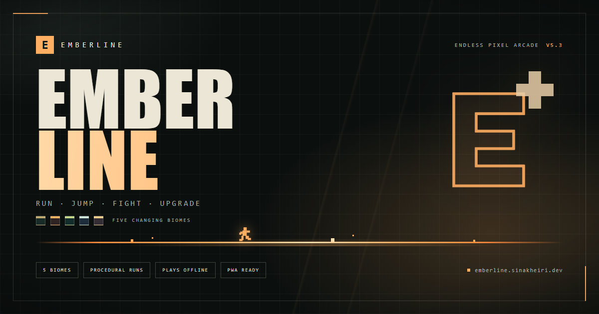

# EMBERLINE



An offline pixel runner with procedural encounters, five changing environments,
original synthesized sound, and an endless score. UI direction follows the
Hermes Claude Design skill used for the original game. The hosted build installs
as an app and keeps playing with no network after the first load.

## Play

Double-click **Play.cmd** for a dedicated Edge window, or open **index.html** in a
modern browser. No build, package installation, server, or network is needed.
Keep the whole folder together: the HTML loads the editable files in `src/`.

| Key        | Action                                            |
| ---------- | ------------------------------------------------- |
| Space / Up | Jump again in air; 2 normally, 3 with Triple Jump |
| Shift      | Dash through enemies; jump over ground hazards    |
| X / J      | Punch or shoot with the selected weapon           |
| L          | Open character, gear and difficulty setup         |
| P          | Pause / resume                                    |
| F          | Fullscreen / windowed                             |
| M          | Sound on / off                                    |
| Enter      | Start / retry / resume                            |

The default difficulty has three integrity points. Embers are the coins: collecting
them gives a combo bonus, helps recharge your dash, and adds difficulty-scaled
coins to your saved spendable balance. Score awards appear at pickups, destroyed targets and cleared hazards.
Losing window focus pauses the run. Touch buttons are included.

## Version 5.3: seamless mobile shell and installable PWA

Phones get one full-height surface instead of stacked page chrome: edge-to-edge
stage, compact score/best/pace readout, four toolbar actions, a particle toggle,
and three large thumb controls. The setup dialog becomes a full-screen sheet.
Safe-area insets cover notches and home bars, and the page never scrolls or
rubber-bands. Landscape keeps the complete 2:1 playfield centred between a
single-row HUD and the touch deck.

On HTTPS the game registers `sw.js`, caches the whole editable source and installs
from the browser's app menu. After the first visit it opens offline. `file://`
launches skip service-worker registration, so Play.cmd is unchanged.

## New in version 5: capped upgrades and balance

The shop opens on **Upgrades**. Each row emphasizes your level, the next benefit,
and the price. A five-segment meter shows progress; advanced stats are under
**Details**. Available coins stay beside the heading. Buying preserves scroll
position and focus. Maxed upgrades cannot be bought again.

| Upgrade       | Limit             | Coin costs              |
| ------------- | ----------------- | ----------------------- |
| Dash          | Level 5           | 100, 200, 300, 400, 500 |
| Jump height   | Level 5           | 100, 200, 300, 400, 500 |
| Attack damage | Level 5           | 100, 200, 300, 400, 500 |
| Triple Jump   | One-time, level 1 | 5,000                   |

Each normal track costs 1,500 coins to max. Upgrades apply on the next run;
buying while paused cannot change current stats. Triple Jump adds one more jump
using Space/Up or the touch control. Landing restores all jumps.

Abilities start at level zero. Dash begins with a short 1.18× burst, an 18px
lunge and 2.80s recharge. Even at level 5 it stays below the old 1.8× dash.
Jump coils gradually increase first- and second-jump height. Damage starts at
×1 and gains 20% per level, capped at ×2. Each dash damages an enemy once per
burst, rather than repeatedly on every frame. Tougher enemies and stacked crates
retain meaningful durability; scatter pellets have lower individual damage.
The starter double jump remains usable for ordinary generated encounters.

| Item                                |    New coin price |
| ----------------------------------- | ----------------: |
| Relay bot / Moon hare / Dust ranger | 500 / 900 / 1,500 |
| Signal ribbons / Storm mantle       |         250 / 600 |
| Twin rockets / Arc coil             |         400 / 800 |
| Pulse blaster / Scatter gun         |     1,200 / 2,400 |

Existing coins and bought gear carry over without being charged again. New
upgrades start at zero. Coin rewards remain 1 / 2 / 3 on preset difficulties;
**Custom still earns zero coins**, even with upgrades or Triple Jump.

## Earned-coin shop

Open **SHOP & UPGRADES** or press **L**. The outfitter now sells skins, capes,
jetpacks and weapons using coins earned in runs. Preview any item; a locked
preview does not change your equipped gear. Use **BUY & EQUIP** to buy once,
then swap owned items for free. The button shows how many more coins you need
when funds are short. Purchases and the remaining wallet persist after reload.

| Difficulty   | Coins per pickup |
| ------------ | ---------------: |
| Night stroll |                1 |
| Courier      |                2 |
| Overdrive    |                3 |
| Custom       |                0 |

Custom is score-only practice, including custom settings harder than Overdrive.
The reward rate is captured when a run starts; changing the pending difficulty
while paused cannot change its earnings. Score/combo bonuses are separate from
coins, and the local pickup popup shows the exact currency award.

The fox, Ember cape, Ember jetpack, impact glove and no-gear options are free.
Other prices are listed above and shown before purchase.
Existing collected coins become the spendable balance without a reset. Old
non-starter selections need purchasing before they can be equipped in this version.

Prices live in `src/economy.js`; reward rates live in `src/loadout.js`. There are
no real-money purchases, accounts or network services.

## New in version 3

Open **SHOP & UPGRADES** before starting, **SHOP / SETUP** from the toolbar,
or press **L**. The preview animates your actual character and equipment. Choices
autosave. Character, cape and jetpack variants have equal movement stats;
the version 4 shop controls which items you own.

- Four characters: Ember fox, Relay bot, Moon hare and Dust ranger.
- Three cloth styles plus no cape. Capes have animated, shaded cloth columns,
  with a fixed shoulder attachment and a moving free edge. Wind, jumps and dashes
  change the silhouette. Jetpacks have single, twin and coil variants, plus none.
- Three real weapons: a short-range impact glove, a precise pulse blaster,
  and a three-bolt scatter gun. Use X/J, click the playfield or use the attack button.
  Bright-seam crates/barriers/stacks break; steel-marked pipes, spikes and reactors
  resist attacks. Enemies can be destroyed; their durability and your damage
  upgrade determine how many hits they take.
- Dash boosts world travel and lunges the courier forward. The camera then catches
  up smoothly. Version 5 starts it at a basic level and caps its upgrades. Ground
  hazards must be jumped or attacked separately.
- A faster default difficulty ramp, plus Night stroll, Courier and Overdrive
  presets. Custom controls tune starting pace, escalation, density and integrity.
  Changing difficulty during a paused run affects the next run; gear updates now.
- Coins are saved as they are collected, including during an unfinished run.
  The top counter is spendable coins; the stage counter is the current run's earnings.
  Local action labels show exact score bonuses, including the coin combo bonus.

## What changed in version 2

- **Speed:** a rising baseline plus randomized cruise, surge and breather phases.
  Transitions accelerate and decelerate smoothly. Speed and pace are shown live.
- **Six hazards:** crates, spikes, barriers, stacked crates, pipes and reactors.
- **Four enemies:** hovering drones, ground crawlers, drifting jellies and bats.
  They have distinct sprites, altitudes, motion and relative speeds.
- **Five backgrounds:** city, foundry, forest, frozen mountains and desert ruins.
  Each has different structures, palette and weather. Sectors crossfade scenery.
- **Seven coin trails:** ground, arc, staircase, high, wave, split and scatter.
- **Mixed generation:** six encounter templates combine randomized variants,
  coin trails, positions and gaps. Shuffle bags prevent immediate template/trail
  repeats. New hazards and templates unlock over the first four sectors.
- **Editable source:** simulation, generation, presentation and input are separate.

## Edit the game

Open this folder in your editor, change the source, save, and refresh the game.
There is **no generated bundle** to rebuild. Node is only needed for development
checks. The browser loads plain scripts in the order listed in `index.html`, so
`file://` launching works without the restrictions of native ES module imports.

```text
index.html                Screen structure and script dependency order
style.css                 Formatted responsive UI styles
sw.js                     Offline precache for the installed PWA
Play.cmd                  Windows dedicated-window launcher
src/
  config.js               Speed, physics, dash and timing constants
  loadout.js              Character/gear/weapon catalogs, difficulty presets and validation
  economy.js              Prices, owned items, wallet migration, permanent purchases
  upgrades.js             Capped progression, upgrade costs and run-stat formulas
  upgrade-panel.js        Level/benefit/price UI with optional details
  combat.js               Punch hitboxes, projectile movement, armor and destruction
  cloth.js                Pure animated cape geometry
  content.js              Hazard/enemy definitions, biomes, paces, pattern catalog
  random.js               Seeded RNG, weighted choices and shuffle bags
  difficulty.js           Smooth speed phases, sector and biome transitions
  generator.js            Encounter assembly, coin paths and clearance rules
  engine.js               Pure simulation, movement, collision and scoring
  pixel.js                Shared pixel primitives and color mixing
  backgrounds.js          Parallax geometry, weather and theme crossfades
  sprites.js              Courier, hazard, enemy and coin drawing registries
  renderer.js             Scene composition; no gameplay rules
  audio.js                Original Web Audio sound synthesis
  particles.js            Bounded particle system
  popups.js               Local score/action labels with bounded lifetime
  wardrobe.js             Accessible setup tabs, preview and custom difficulty controls
  storage.js              Safe best-score and preference persistence
  ui.js                   HUD, overlays and announcements
  input.js                Keyboard, touch and focus handling
  pwa.js                  Service-worker registration (HTTP/HTTPS only)
  app.js                  Coordinates simulation, presentation and UI
  main.js                 Browser entry point and optional debug hook
tests/                    Node regression and generation tests
scripts/check.cjs         Syntax checker
scripts/browser-check.cjs Optional Edge/Chromium integration checks
scripts/gear-browser-check.cjs Gear, difficulty, coins and combat integration checks
scripts/shop-browser-check.cjs Purchases, insufficient funds and difficulty reward integration
scripts/upgrades-browser-check.cjs Level caps, purchases, persistence and actual Triple Jump
docs/DEVELOPMENT.md        Recipes for extending content and tuning the game
```

## Reset saved progress

Open the shop with **L**, choose **Settings**, then **Reset Progress**. The first
click shows a confirmation; **Keep My Progress** or Escape cancels it. Confirming
**Reset & Restart** removes coins, purchased gear, upgrade levels, best score and
equipped loadout/difficulty, ends the current run and returns to the title screen.
Sound and particle preferences are kept. Only this browser's EMBERLINE save is
affected; unrelated site data is never cleared.

## Website metadata and preview assets

Configured public URL: **https://emberline.sinakheiri.dev/**. Title, description,
canonical URL, Open Graph and X/Twitter cards are saved directly in the HTML head,
along with `VideoGame` structured data. Social-image URLs are absolute; game,
favicon and app-icon paths remain local so Desktop launching continues to work.

- `assets/og-image.png`: 1200×630 designed cover, also the repo preview.
- `assets/preview-square.png`: 1080×1080 designed square cover.
- `PREVIEW.png`: copy of the wide cover for tools that expect a root preview.
- `assets/favicon.svg` and `favicon.ico`: browser favicons, with PNG fallbacks.
- `assets/icon-180.png`: Apple touch icon.
- 192px/512px icons plus a padded maskable icon for the web manifest.
- `site.webmanifest`, `robots.txt`, and `sitemap.xml`: static app/crawl metadata.

Edit `site.config.json`, then run `npm run metadata` to update the HTML metadata,
manifest and crawl files. `npm run assets` regenerates the icons and both cover
images (vector HTML/CSS rendered to PNG, not game screenshots); it needs the
same optional Playwright setup as browser tests.
The generated image files are already included, so playing needs no tools.
Upload the entire folder when deploying; the absolute sharing URLs expect assets
under `/assets/` on the configured domain, and `sw.js` must stay at the root so
its scope covers the game. `sw.js` precaches the page, stylesheet, manifest,
icons and every `src/` script. Bump its `CACHE` name whenever a cached file
changes, otherwise installed clients keep the previous build. Service workers
require HTTP or HTTPS; the local Desktop version already runs offline and
skips registration on `file://`.

## Development checks

With Node 18 or newer installed:

```sh
npm test
npm run check
```

These commands need no npm installation. The optional browser suite requires
Playwright: `npm install --no-save playwright@1.62.1`, then `npm run test:browser`.
It uses installed Microsoft Edge by default; set `BROWSER_CHANNEL=chrome` for
Chrome. For a separately installed Playwright, set `PLAYWRIGHT_MODULE` to its
module directory. Browser tests write screenshots to ignored `test-results/`.
Use `npm run format` after installing Prettier 3.6.2 if you want automatic source
formatting. Both tools are development-only and are not required to play.

## Reproducible runs

Open `index.html?seed=my-route` to replay the same procedural choices. Reproducing
the exact outcome also requires the same difficulty, equipment and input timing. Normal launches use a
fresh random seed. Add `&dev=1` to expose the documented debug API; no debug
interface or cheat controls appear in the normal game.

Speed rises without a fixed ceiling; score uses `BigInt` and has no numeric cap.
Spacing scales with speed and future acceleration, and collisions use small
simulation steps plus swept horizontal checks. This is a casual endless game,
not a formally proven solvable platformer at arbitrarily large run durations.
